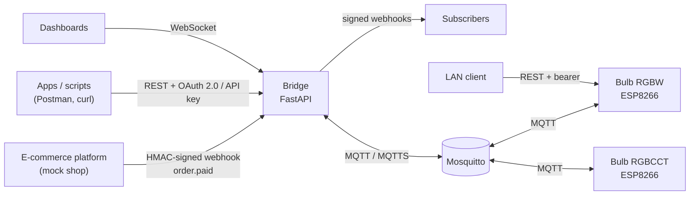

# Smart Bulb Platform: ESP8266 firmware + cloud integration bridge

[](../../actions/workflows/ci.yml)

A complete connected-device stack, from the LED driver up to signed e-commerce webhooks:

- **Firmware** (C++, ESP8266): one codebase for two Wi-Fi smart bulbs, controlled over MQTT and a local REST API.
- **Bridge** (Python, FastAPI): connects the bulbs to other software. It offers a REST API with OAuth 2.0 and API keys, signed webhooks in both directions, a live WebSocket feed, and MQTT/MQTTS on the device side.
- **Simulators**: virtual bulbs that speak the same protocol as the real ones, plus a mock shop, so you can run everything without hardware.

> **Background.** This is an original implementation, written from scratch. It's inspired by smart-bulb firmware I worked on professionally in 2020, and contains no proprietary code, names or credentials.



## Try it in 2 minutes (no hardware)

```sh
docker compose up --build
```

That starts Mosquitto, the bridge, two simulated bulbs and an example webhook subscriber. Then:

```sh
# 1. get an OAuth 2.0 token (client credentials)
TOKEN=$(curl -s -u shop-backend:demo-client-secret-0123456789 \
  -d grant_type=client_credentials http://localhost:8000/oauth/token | jq -r .access_token)

# 2. see the bulbs
curl -s -H "Authorization: Bearer $TOKEN" http://localhost:8000/devices | jq

# 3. set warm white and wait for the bulb to confirm
curl -s -H "Authorization: Bearer $TOKEN" -H "Content-Type: application/json" \
  -d '{"color_temp":370,"brightness":140}' http://localhost:8000/devices/sim-rgbcct/commands | jq

# 4. a paid order flashes the bulb green for 4 s, then restores it exactly
cd bridge && pip install -e . && \
python -m simulators.shop_sim --secret demo-shop-secret-0123456789 --type order.paid
```

Watch the `webhook-receiver` container's logs: it prints each signed event it verifies. Interactive API docs are at http://localhost:8000/docs, and [docs/postman_collection.json](docs/postman_collection.json) covers the same flow in Postman, including a pre-request script that signs the webhook.

*All credentials above are demo values from [deploy/demo.env](deploy/demo.env). They're public and exist only for local use.*

## What it demonstrates

| Area | Where |
|---|---|
| **MQTT**: retained state, Last Will availability, QoS 1, reconnect with backoff, Home Assistant discovery | `src/MqttLink.*`, `bridge/bulb_bridge/mqtt_bridge.py` |
| **MQTTS**: TLS 1.2+, private CA pinning, hostname verification | `mqtt_bridge.build_tls_context`, [docs/MQTTS.md](docs/MQTTS.md) |
| **REST API**: validation at the edge, capability checks, command confirmation (200/202/422/409/503) | `bridge/bulb_bridge/routes.py` |
| **OAuth 2.0**: client-credentials grant (RFC 6749 §4.4), scoped short-lived JWTs, pinned algorithm | `auth.py`, `POST /oauth/token` |
| **API keys / bearer tokens**: hashed at rest, scope-based authorization | `auth.py` |
| **HMAC signature verification**: timestamped signatures, replay window, constant-time compare, secret rotation | `signing.py` |
| **Webhook handlers**: raw-body verification, idempotency, retry-safe status codes, size limits | `routes.shop_webhook`, `idempotency.py` |
| **Outbound webhooks**: signed deliveries, retries with exponential backoff and jitter, retry policy per status code | `webhooks_out.py` |
| **WebSockets**: first-message auth, snapshot then live events, slow-consumer protection | `routes.events_ws`, `registry.py` |
| **E-commerce automation**: order → bulb alert → exact state restore, correct under overlapping alerts | `automations.py` |
| **Wi-Fi device setup**: captive-portal setup, per-device WPA2 password, power-cycle reset | `src/Portal.*`, `src/main.cpp` |
| **Embedded**: non-blocking PWM fades, gamma correction, power-loss-safe flash writes | `src/LedOutput.*`, `src/Storage.*` |

## Testing

| Suite | What | Runs |
|---|---|---|
| Firmware unit tests (20) | Colour mixing, command protocol, persistence, discovery, backoff, password generator | `pio test -e native` (CI) |
| Bridge tests (82) | Auth (incl. expired / forged / `alg=none` tokens), webhooks (tampered / stale / duplicate / broker down), WebSocket auth, automations, MQTT parsing, retry policy | `cd bridge && pytest` |
| End-to-end (13 checks) | The real stack: OAuth → REST → MQTT → bulb → confirmation, live WebSocket events, signed webhooks, flash-and-restore, outbound signature check, offline detection | `python bridge/scripts/e2e_smoke.py` against `docker compose` (CI) |

The security-critical paths were also **mutation-tested**: each one was deliberately broken to confirm a test fails. [docs/BUILD_LOG.md](docs/BUILD_LOG.md) records the real problems hit during the build and how each was fixed.

---

## Firmware

One codebase builds two bulb variants:

| Variant | Channels | Colour modes |
|---|---|---|
| `rgbw` | Red, green, blue + cool white | RGB, white |
| `rgbcct` | Red, green, blue + cool white + warm white | RGB, tunable white (2700–6500 K) |

- **Works without the network:** the bulb restores its last state as soon as it gets power, before Wi-Fi starts.
- **Setup through a captive portal:** the bulb opens a WPA2 access point called `Bulb-xxxxxx` with a setup page listing nearby networks. Each device gets its own random password, created on first boot. No shared factory password exists.
- **Reset by power-cycling:** switch it off and on 3 times, each within 5 seconds of power-on, and it opens setup again.
- **Strict commands:** a command is applied completely or not at all. The reason for a rejection is published on `bulb/<id>/error`.
- **Safe flash writes:** temp file plus rename, so cutting power mid-write can't corrupt settings. Changes are batched to reduce flash wear.
- **Local REST API:** `GET/POST /api/state` on the bulb itself, with bearer authentication (the device password) and a constant-time comparison.
- **OTA updates:** password-protected.

```
lib/bulb_core/   plain C++, unit-tested on the host: state model, colour math, protocol, network helpers
src/             ESP8266: LED driver, storage, setup portal, MQTT link, local REST API, main loop
```

### MQTT API

`<id>` is the last 6 hex digits of the chip ID.

| Topic | Direction | Retained | Payload |
|---|---|---|---|
| `bulb/<id>/set` | in | — | Command JSON |
| `bulb/<id>/state` | out | yes | Full state JSON |
| `bulb/<id>/availability` | out | yes | `online` / `offline` (Last Will) |
| `bulb/<id>/error` | out | no | Why the last command was rejected |
| `homeassistant/light/<id>/config` | out | yes | Discovery config |

| Command field | Values | Notes |
|---|---|---|
| `state` | `"ON"`, `"OFF"`, `"TOGGLE"` | |
| `brightness` | 0–255 | `0` turns off but remembers the previous level |
| `color` | `{"r":0-255,"g":0-255,"b":0-255}` | Switches to RGB mode |
| `color_temp` | mireds, 153–370 | `rgbcct` only; clamped |
| `white` | 0–255 | White mode at that brightness |
| `effect` | `"none"`, `"pulse"` | |
| `transition` | seconds | Fade time; default 0.3 s, max 60 s |

### Build and flash

```sh
pio run                        # build both variants
pio run -e rgbcct -t upload    # flash over USB-serial
pio device monitor             # serial console, 115200 baud
```

The default pins (R=4, G=12, B=14, CW=5, WW=13) match a common ESP8266 bulb layout. Check your board before flashing. The build is about 411 KB on a 1 MB module, which leaves room for OTA.

## Bridge

```
bridge/bulb_bridge/
  main.py          app factory and lifespan (MQTT thread, webhook dispatcher)
  routes.py        REST, OAuth token endpoint, shop webhook, WebSocket
  auth.py          API keys + OAuth 2.0 client credentials (JWT), scopes
  signing.py       HMAC-SHA256 signatures (inbound and outbound)
  mqtt_bridge.py   paho-mqtt client, MQTTS, topic parsing, thread hand-off
  registry.py      device state and event bus
  automations.py   shop event -> bulb rules with exact state restore
  webhooks_out.py  signed outbound deliveries with retries
  idempotency.py   duplicate-delivery protection
bridge/simulators/ virtual bulb (same rules as the firmware), mock shop, webhook receiver
```

Configuration comes from environment variables. [deploy/demo.env](deploy/demo.env) is a complete annotated example. Generate real secrets with `python -m bulb_bridge.cli new-secret` and hash API keys / client secrets with `python -m bulb_bridge.cli hash <secret>`. Only hashes go in the config.

**Known limits, by design for a demo:**
- Device state and idempotency keys live in memory, per process. Running several replicas would need Redis or similar.
- The automation restore timer doesn't survive a bridge restart.

## Security notes

- No secrets in source. Each device generates its own password; the bridge config stores only hashes of API keys and client secrets.
- Webhook signatures include a timestamp (replay window) and are compared in constant time. Several active secrets allow rotation with no downtime.
- JWTs are short-lived (15 min), scoped, and checked for issuer, audience and expiry, with a pinned algorithm.
- Bulbs store Wi-Fi/MQTT credentials in plain text in flash, as is normal for this class of device. The bulb-to-broker link is plain MQTT on the LAN. See [docs/MQTTS.md](docs/MQTTS.md) for the TLS setup and the reasoning.

## License

MIT. See [LICENSE](LICENSE).
